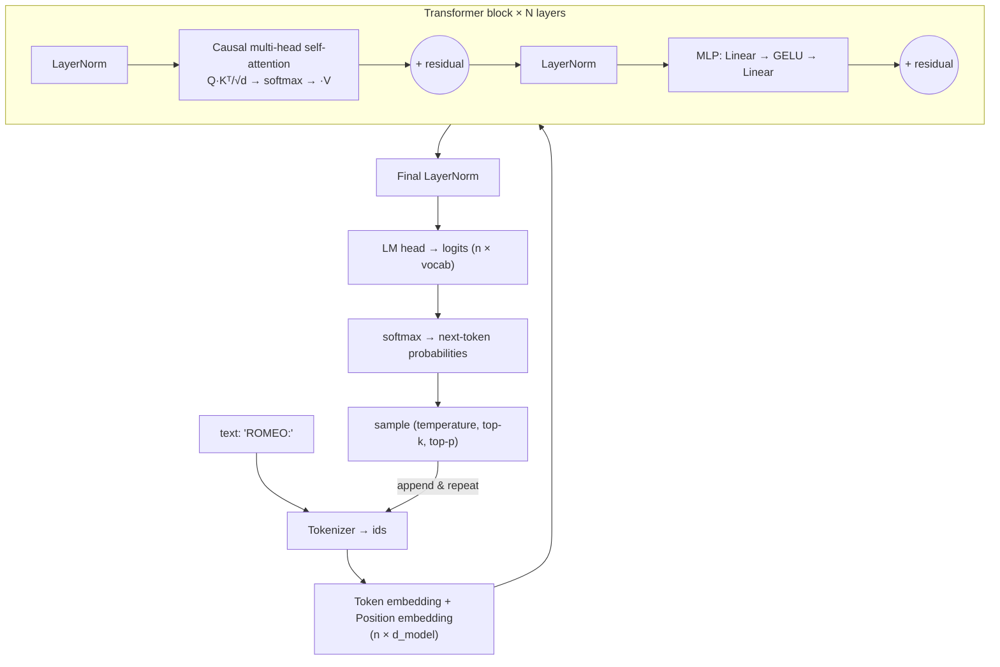

# tiny-llm-java

**A GPT-style Large Language Model written from scratch in plain Java — no libraries, no GPU, no Python.**
Train it on your laptop in about 10–25 minutes (22 min measured on 2 CPU cores) and watch it learn to write Shakespeare-like text.

```
ROMEO:
I'll not not me freshore: he and your gentlement me;
This cause say your blooding to cheeds of Edward wear
My lade strangth the lame: how that the fall.

Thoughts Are secul:
Good make all feart me more. She that what it me of
our daughted again. See is a whish matter'd more
```
*(real output from the model in this repo, after 2,000 training steps on a 2-core CPU)*

Every piece that a framework like PyTorch normally hides is in here and readable:
tokenizer, embeddings, multi-head causal self-attention, LayerNorm, GELU feed-forward network,
residual connections, cross-entropy loss, **hand-written backpropagation**, AdamW, learning-rate
warmup + cosine decay, gradient clipping, checkpointing, and temperature / top-k / top-p sampling.

> 📖 Companion article: [`ARTICLE.md`](ARTICLE.md) — *"How LLMs Actually Work: Build a GPT in Pure Java and Train It on Your Laptop"*

---

## Quick start

Requirements: **JDK 17 or newer**. That's it.

```bash
git clone https://github.com/<your-username>/tiny-llm-java.git
cd tiny-llm-java

./run.sh gradcheck   # 1. prove the hand-written backprop is correct (5 seconds)
./run.sh train       # 2. train on data/tinyshakespeare.txt (writes checkpoints/model.bin)
./run.sh generate --prompt "ROMEO:" --tokens 500     # 3. generate text
```

Prefer Maven (works on Windows too)?

```bash
mvn package
java -cp target/classes dev.tinyllm.Train    --steps 2000
java -cp target/classes dev.tinyllm.Generate --prompt "JULIET:" --temperature 0.7
```

Train on **your own text**: point `--data` at any UTF-8 `.txt` file (song lyrics you wrote, your blog
posts, source code, a public-domain book from Project Gutenberg…). ~1 MB or more works best.

```bash
./run.sh train --data my_notes.txt --steps 4000 --out checkpoints/notes.bin
./run.sh generate --model checkpoints/notes.bin --prompt "Today I"
```

---

## What training looks like

```
Params:  818,176
step     1 | loss 4.1958 | lr 3.00e-05 | grad-norm 6.27 | 833.9 tok/s
step   500 | loss 2.0510 | lr 2.72e-03 | grad-norm 0.68 | 1531.2 tok/s
---- eval @ 500: val loss 2.1446 | perplexity 8.54
step  1000 | loss 1.7379 | lr 1.76e-03 | grad-norm 0.75 | 1521.9 tok/s
---- eval @ 1000: val loss 1.8766 | perplexity 6.53
step  1500 | loss 1.6940 | lr 7.36e-04 | grad-norm 0.68 | 1531.4 tok/s
---- eval @ 1500: val loss 1.7554 | perplexity 5.79
step  2000 | loss 1.5487 | lr 3.00e-04 | grad-norm 0.83 | 1525.8 tok/s
---- eval @ 2000: val loss 1.7324 | perplexity 5.65
Done in 22.4 min. Best val loss 1.7324. Checkpoint: checkpoints/model.bin
```

* **loss** starts at ≈ 4.17 = ln(65): the model is guessing uniformly among 65 characters.
* **val loss / perplexity** is measured on text the model never trains on. Perplexity ≈ "how many
  characters the model is still choosing between". Going from 65 → ~5 means it has really learned something.
* If train loss keeps falling but val loss rises, the model is **overfitting** (memorising instead of learning).

---

## Project layout

| File | What it is | LLM concept |
|---|---|---|
| `CharTokenizer.java` | text ⇄ integer ids | tokenization, vocabulary |
| `Config.java` | model size knobs | hyperparameters, context window, d_model, heads, layers |
| `GPT.java` | the network + backprop | embeddings, self-attention, causal mask, LayerNorm, MLP, residuals, logits, loss |
| `AdamW.java` | optimizer + gradient clipping | weight updates, momentum, weight decay |
| `Train.java` | training loop | pre-training, batches, LR schedule, validation, checkpoints, data parallelism |
| `Sampler.java` | text generation | autoregressive decoding, temperature, top-k, top-p |
| `Generate.java` | CLI for inference | streaming tokens |
| `GradCheck.java` | numerical gradient test | verifying backprop |

## Architecture



## Knobs (`./run.sh train --key value`)

| Flag | Default | Meaning |
|---|---|---|
| `--data` | `data/tinyshakespeare.txt` | training corpus |
| `--steps` | 2000 | optimizer steps |
| `--batch` | 16 | sequences per step |
| `--ctx` | 64 | context window (tokens the model can see) |
| `--dmodel` | 128 | embedding width |
| `--heads` | 4 | attention heads |
| `--layers` | 4 | transformer blocks |
| `--lr` | 3e-3 | peak learning rate |
| `--warmup` | 100 | warmup steps |
| `--threads` | all cores | parallel workers |
| `--out` | `checkpoints/model.bin` | where to save the best model |

Generation: `--model`, `--prompt`, `--tokens`, `--temperature` (0 = greedy), `--top-k`, `--top-p`, `--seed`.

**Faster run** (≈3 min, rougher text): `./run.sh train --dmodel 64 --layers 2 --steps 1500`
**Better run** (longer): `./run.sh train --dmodel 192 --layers 6 --heads 6 --ctx 128 --steps 6000`

## This model vs. a real LLM

| | tiny-llm-java | GPT-3 (2020 paper) |
|---|---|---|
| Parameters | ~0.8 M | 175 B |
| Layers | 4 | 96 |
| d_model | 128 | 12,288 |
| Heads | 4 | 96 |
| Context window | 64 tokens | 2,048 tokens |
| Tokenizer | characters (65) | BPE (50,257) |
| Training data | 1 MB | ~300 B tokens |
| Hardware | your laptop CPU | thousands of GPUs |

Same architecture, same math. The difference is scale — plus, for chat assistants, extra stages
(instruction tuning and RLHF) that come after the pre-training you do here.

## Credits

Inspired by Andrej Karpathy's *nanoGPT* / *llm.c* and the paper *Attention Is All You Need* (2017).
Dataset: Tiny Shakespeare (public domain). License: MIT.
